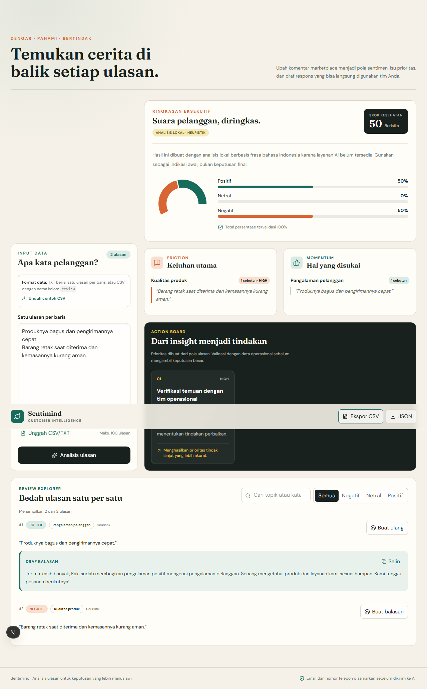
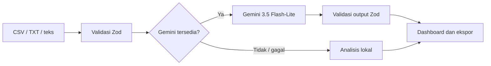

# Sentimind

Sentimind adalah web app customer intelligence yang mengubah kumpulan ulasan pelanggan Indonesia menjadi distribusi sentimen, tema keluhan dan pujian, rekomendasi prioritas, serta draf balasan customer service.



## Fitur utama

- Analisis hingga 100 ulasan sekaligus dari teks, TXT, atau CSV.
- Klasifikasi positif, netral, dan negatif untuk bahasa Indonesia informal.
- Ringkasan eksekutif, skor kesehatan, topik utama, dan action board.
- Draf balasan yang menyesuaikan sentimen setiap ulasan.
- Ekspor JSON dan CSV yang rapi untuk Excel/Google Sheets.
- Badge transparan yang membedakan hasil Gemini dari fallback lokal.
- Redaksi email dan nomor telepon sebelum data dikirim ke Gemini.
- Rate limiting lintas instance dengan Upstash Redis di production.

## Arsitektur



- Next.js App Router menangani UI dan API route dalam satu aplikasi.
- Gemini hanya dipanggil dari server; API key tidak masuk ke browser.
- Output model diperlakukan sebagai data tidak tepercaya dan divalidasi sebelum dirender.
- Analisis identik disimpan dalam cache proses selama 30 menit untuk konsistensi dan efisiensi.
- Keputusan ketahanan AI dan rate limiting dicatat di [ADR-001](docs/decisions/0001-resilient-ai-analysis.md).

## Teknologi

- Next.js 16, React 19, dan TypeScript
- Tailwind CSS 4
- Google Gemini API (`gemini-3.5-flash-lite`)
- Zod, Papa Parse, dan Recharts
- Upstash Redis Rate Limit
- Vitest dan Playwright

## Menjalankan lokal

Prasyarat: Node.js 22.13 atau lebih baru.

```bash
npm ci
Copy-Item .env.example .env.local
npm run dev
```

Buka `http://localhost:3000`.

Isi variabel berikut di `.env.local`:

```env
GEMINI_API_KEY=your_gemini_api_key
GEMINI_MODEL=gemini-3.5-flash-lite
NEXT_PUBLIC_SITE_URL=http://localhost:3000
```

Tanpa `GEMINI_API_KEY`, aplikasi tetap berfungsi menggunakan analisis lokal dan menampilkan badge `Analisis lokal · heuristik`.

Untuk rate limiting yang konsisten pada deployment serverless, tambahkan:

```env
UPSTASH_REDIS_REST_URL=your_upstash_rest_url
UPSTASH_REDIS_REST_TOKEN=your_upstash_rest_token
```

Tanpa kredensial Upstash, limiter lokal terbatas digunakan untuk development. Jangan mengandalkan limiter lokal untuk deployment multi-instance.

## Format data

Teks dapat ditempel satu ulasan per baris. Untuk CSV, gunakan kolom `review`:

```csv
review
"Produknya bagus, bahannya nyaman"
"Pengiriman terlambat dua hari"
"Admin cepat menjawab pertanyaan saya"
```

Contoh siap pakai tersedia di [`public/contoh-ulasan.csv`](public/contoh-ulasan.csv).

## Perintah

| Perintah | Fungsi |
|---|---|
| `npm run dev` | Menjalankan development server |
| `npm run lint` | Memeriksa aturan ESLint dan Core Web Vitals |
| `npm run typecheck` | Memeriksa tipe TypeScript |
| `npm test` | Menjalankan unit dan integration test |
| `npm run test:e2e` | Menjalankan alur browser Playwright |
| `npm run build` | Membuat production build |

## Quality dan keamanan

Pipeline GitHub Actions menjalankan lint, type-check, test, build, audit dependency, dan E2E pada setiap push atau pull request ke `main`.

Kontrol yang diterapkan:

- Validasi batas API dan output Gemini menggunakan Zod.
- Batas panjang input dan maksimum 100 ulasan per analisis.
- Perlindungan prompt injection melalui pemisahan instruksi dan data ulasan.
- Netralisasi formula spreadsheet pada ekspor CSV.
- CSP, HSTS production, anti-framing, dan security headers lainnya.
- Rate limit 10 analisis/menit dan 20 pembuatan balasan/menit per alamat klien.

## Deployment

Aplikasi siap digunakan pada platform Node.js seperti Vercel. Sebelum production:

1. Atur semua environment variable pada dashboard hosting.
2. Gunakan URL deployment sebagai `NEXT_PUBLIC_SITE_URL`.
3. Hubungkan Upstash Redis untuk rate limiting lintas instance.
4. Jalankan smoke test: analisis, balasan, ekspor CSV, dan fallback tanpa Gemini.
5. Aktifkan branch protection agar workflow CI wajib lulus sebelum merge.

## Batasan

- Fallback lokal menggunakan aturan kata dan tidak sehalus Gemini.
- Cache analisis berada dalam proses aplikasi dan bukan penyimpanan permanen.
- Skor kesehatan adalah insight operasional, bukan metrik statistik atau keputusan bisnis final.
- Email dan nomor telepon disamarkan; pengguna tetap harus menghindari memasukkan data pribadi sensitif lainnya.

## Lisensi

[MIT](LICENSE)
